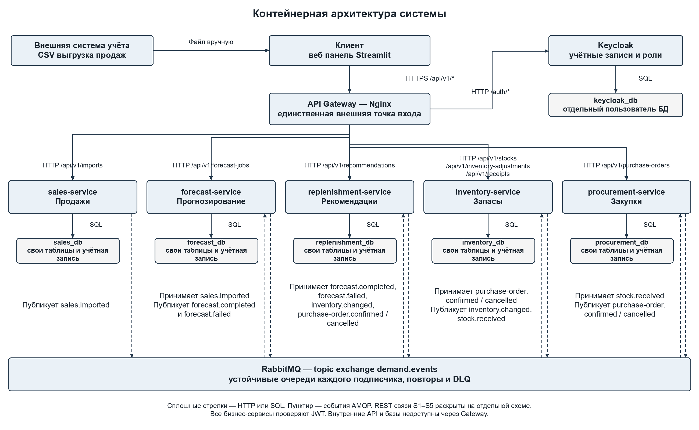
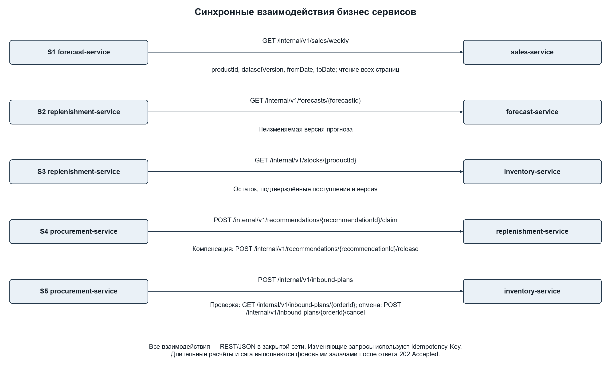
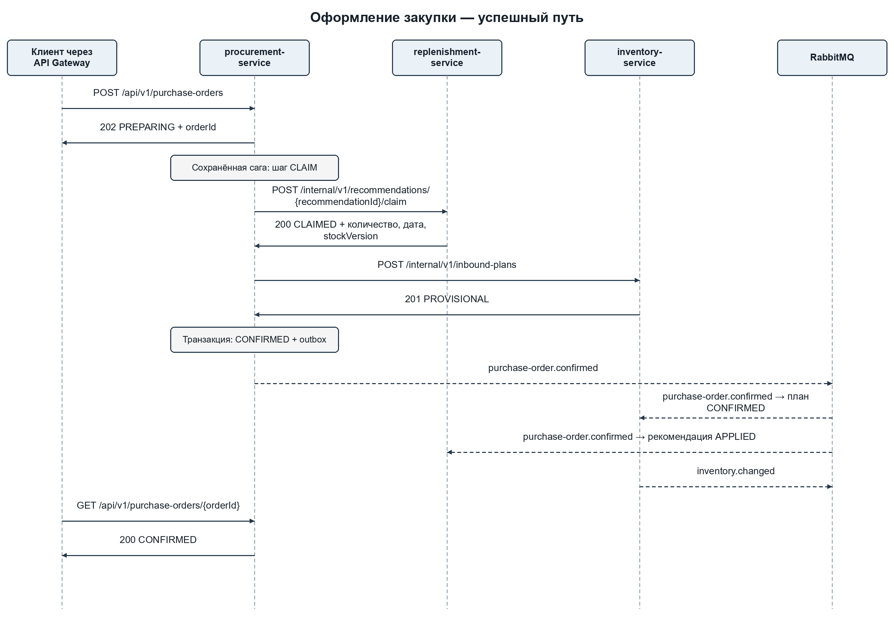
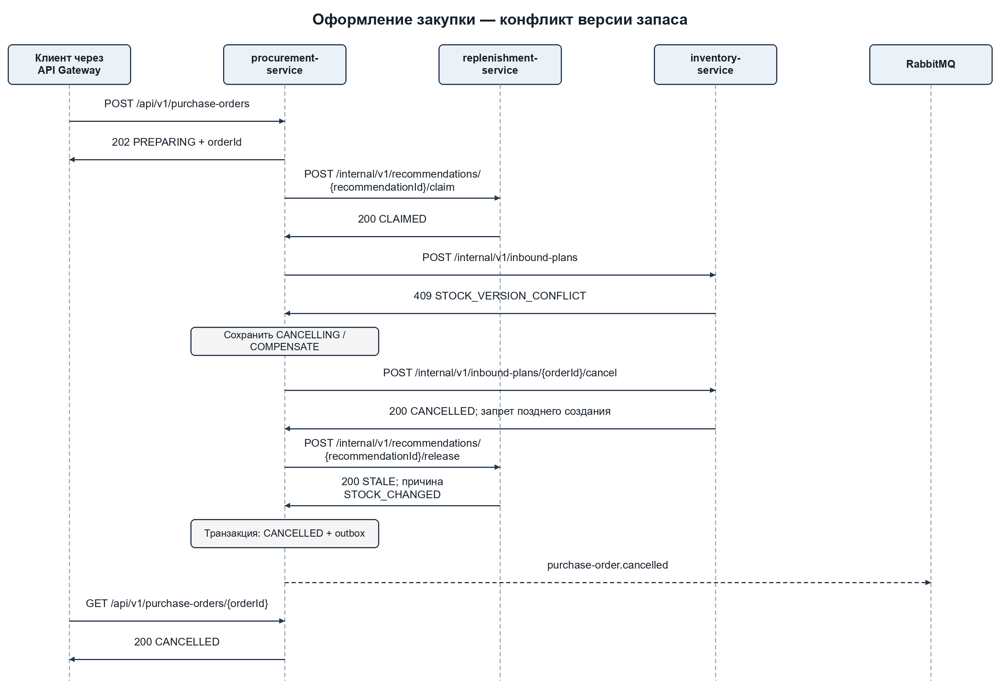

# Прогнозирование спроса и планирование закупок

**Лабораторная работа № 3 — декомпозиция и проектирование микросервисной системы.**

Криворучко Кирилл, группа ВМО-41. Репозиторий используется как основа для следующих лабораторных: сейчас подготовлены проект, схемы и контракты; реализация сервисов будет добавляться по этапам.

## Содержание

1. [Описание предметной области, акторы и пользовательские сценарии](#section-1)
2. [Доменные события и ограниченные контексты с глоссариями](#section-2)
3. [Карточки сервисов и отвергнутые варианты разбиения](#section-3)
4. [Таблица выбранного ПО с обоснованием](#section-4)
5. [Архитектура, диаграммы последовательности и взаимодействия](#section-5)
6. [Перечень событий и ссылки на схемы сообщений](#section-6)
7. [Ссылки на OpenAPI и проверка спецификаций](#section-7)

<a id="section-1"></a>

## 1. Описание предметной области, акторы и пользовательские сценарии

### Назначение системы

Система предназначена для закупщика небольшого торгового предприятия и аналитика продаж. Она принимает историю продаж, строит прогноз по товарам и рассчитывает рекомендуемое пополнение с учётом остатка и подтверждённых поставок. Закупщик выбирает рекомендацию и оформляет по ней внутренний заказ поставщику. Складской сотрудник регистрирует поступление, после чего система обновляет запас. Сервис сохраняет версии исходных данных, прогнозов и решений, поэтому происхождение рекомендации можно проследить.

Цель лабораторной работы — спроектировать границы сервисов, выбрать инфраструктуру и определить проверяемые контракты взаимодействий. Реализация и развёртывание относятся к следующим лабораторным; данный отчёт содержит проектные решения и спецификации.

### Границы и допущения

- Один склад WH-1, один условный поставщик, целочисленные единицы товара; расчёты ведутся по товарам независимо.
- Пересмотр запаса R = 1 неделя, фиксированный срок поставки L = 1 неделя. Период защиты R + L = 2 недели. Поставки в учебной модели поступают на границе недель.
- Загрузка истории — полный CSV-снимок, а не добавление новых строк. Успешный импорт создаёт неизменяемую datasetVersion. Личные данные покупателей не требуются.
- Прогнозируются зарегистрированные продажи. При отсутствии остатков в исходном наборе скрытый неудовлетворённый спрос не восстанавливается.
- Остатки для лабораторного сценария вводятся пользователем и изменяются корректировками и поступлениями. Прямое подключение к ERP и автоматическое списание по каждой новой продаже остаются за границей этой версии.
- Заказ подтверждается внутри проектируемой системы. Отправка реальному поставщику, оплата, частичные поступления и отмена уже подтверждённой закупки не входят в объём работы.
- Прогноз суммарных продаж на две недели содержит p10, p50 и p90. Политика policy-v1 использует p90 как выбранный уровень обслуживания; оптимальность затрат и точная вероятность дефицита не заявляются.

### Акторы и внешние системы

| Актор | Действия |
| --- | --- |
| Аналитик analyst | Загружает продажи, запускает прогнозирование, изучает прогнозы и рекомендации. |
| Закупщик purchaser | Просматривает рекомендации, оформляет закупку, проверяет её статус и отменяет незавершённое оформление. |
| Складской сотрудник warehouse-manager | Просматривает запас, выполняет корректировку и регистрирует полное поступление. |
| Администратор admin | Управляет ролями и настройками инфраструктуры; разбирает сообщения DLQ. |
| Внешняя система учёта | Источник CSV. Файл передаётся пользователем через веб-панель; прямого API-подключения в этой версии нет. |
| Keycloak | Внешний по отношению к бизнес-сервисам поставщик учётных данных и JWT; обслуживается через Gateway /auth/*. |

### Пользовательские сценарии

1. Как аналитик, я хочу загрузить выгрузку продаж, чтобы получить проверенную версию истории для расчётов.
2. Как аналитик, я хочу видеть число принятых и отклонённых строк, чтобы исправлять проблемы выгрузки.
3. Как аналитик, я хочу запускать прогноз по товару на две недели, чтобы оценить будущий объём продаж.
4. Как закупщик, я хочу видеть прогноз, запас и рекомендованное количество, чтобы обосновать закупку.
5. Как закупщик, я хочу оформить закупку из выбранной рекомендации, чтобы не переносить количество и дату вручную.
6. Как закупщик, я хочу узнать итог оформления и отменить ещё не подтверждённую закупку, чтобы управлять незавершёнными действиями.
7. Как складской сотрудник, я хочу корректировать остаток и регистрировать поступление, чтобы рекомендации использовали актуальный запас.
8. Как администратор, я хочу видеть идентификатор сквозного сценария и неуспешные сообщения, чтобы восстановить обработку после сбоя.

<a id="section-2"></a>

## 2. Доменные события и ограниченные контексты с глоссариями

Доменные события обозначают уже произошедшие факты. Название routing key сохраняется в поле eventType. Рабочая команда саги выполняется адресным REST-запросом; факт подтверждения или отмены заказа распространяется событием.

| Событие | Факт | Ограниченный контекст |
| --- | --- | --- |
| sales.imported | Продажи успешно импортированы | Продажи |
| forecast.completed | Прогноз рассчитан и сохранён | Прогнозирование |
| forecast.failed | Задание прогнозирования завершилось ошибкой | Прогнозирование |
| inventory.changed | Изменена версия запаса или подтверждённой поставки | Запасы |
| purchase-order.confirmed | Закупка подтверждена | Закупки |
| purchase-order.cancelled | Оформление закупки отменено после компенсаций | Закупки |
| stock.received | Полное поступление по заказу зарегистрировано | Запасы |

#### Глоссарий контекста продаж

| Термин | Значение в контексте |
| --- | --- |
| Продажа | Положительная операция реализации товара; возвраты и отмены учитываются при проверке, но исключаются из ряда продаж. |
| Импорт | Задание проверки и загрузки полного снимка истории. |
| Версия набора | Неизменяемая datasetVersion, опубликованная после успешного импорта. |
| Недельный ряд | Количество зарегистрированных продаж товара за полные календарные недели. |

#### Глоссарий контекста прогнозирования

| Термин | Значение в контексте |
| --- | --- |
| Задание | Фоновый расчёт с состояниями PENDING, RUNNING, SUCCEEDED или FAILED. |
| Прогноз | Неизменяемая оценка суммарных продаж за период защиты для конкретной версии данных. |
| Квантиль p90 | Уровень суммарных продаж, соответствующий выбранной квантильной оценке 0,9. |
| Версия модели | Идентификатор алгоритма и сохранённых параметров, использованных при расчёте. |

#### Глоссарий контекста запасов

| Термин | Значение в контексте |
| --- | --- |
| Остаток | Физически доступное количество товара на складе. |
| План поступления | Ожидаемая поставка, связанная с orderId; до подтверждения имеет статус PROVISIONAL. |
| Позиция запаса | Остаток плюс подтверждённые неполученные поставки на периоде защиты. |
| Версия запаса | Монотонная версия stockVersion для проверки устаревших расчётов. |

#### Глоссарий контекста пополнения

| Термин | Значение в контексте |
| --- | --- |
| Рекомендация | Версионированный результат расчёта количества пополнения по прогнозу и снимку запаса. |
| Целевой уровень | S = ceil(p90) суммарных продаж за две недели. |
| Закрепление | Исключительное назначение выбранной версии рекомендации одному orderId. |
| Устаревшая рекомендация | Результат STALE, рассчитанный по более старой версии запаса или утративший срок действия. |

#### Глоссарий контекста закупок

| Термин | Значение в контексте |
| --- | --- |
| Заказ поставщику | Внутренний документ с товаром, количеством, датой поступления и состоянием оформления. |
| Сага | Сохранённая последовательность закрепления рекомендации, подготовки поступления и подтверждения заказа. |
| Подтверждение | Локальная фиксация CONFIRMED и события в outbox; точка принятия решения сагой. |
| Компенсация | Отмена предварительного поступления и освобождение закрепления при отказе до подтверждения. |

<a id="section-3"></a>

## 3. Карточки сервисов и отвергнутые варианты разбиения

Выделено пять бизнес-сервисов. Gateway, Keycloak, брокер, СУБД и веб-панель являются инфраструктурой или клиентом и в это число не входят. Границы проходят по бизнес-возможностям и владению данными; независимость достигается собственными транзакциями и отсутствием прямого чтения чужих таблиц.

### sales-service

Ответственность. Обеспечивает пригодную для анализа историю продаж: проверяет полный снимок, нормализует операции и предоставляет недельные ряды.

Владеет данными. imports, datasets, sales_transactions, weekly_sales; собственные файлы исходных CSV и протоколы проверки в sales-files.

Предоставляет. POST /api/v1/imports; GET /api/v1/imports/{importId}; GET /internal/v1/sales/weekly; событие sales.imported.

Зависит от. Не вызывает другие бизнес-сервисы. Отправляет события через RabbitMQ; авторизацию проверяет по JWT.

Нефункциональные требования. Цель: CSV до 100 MiB и до 1 млн строк; приём задания до 1 с, обработка до 120 с; p95 чтения страницы ряда до 300 мс. Одновременно обрабатывается один импорт.

Обоснование границы. Импорт и очистка имеют собственную семантику версий и ошибок. Пакетная запись отличается по нагрузке от прогнозирования. Исходная история остаётся единственным источником истины.

### forecast-service

Ответственность. Строит прогноз продаж на две недели, управляет заданиями и сохраняет модель и результат вместе с версиями исходных данных.

Владеет данными. forecast_jobs, forecasts, model_versions; артефакты моделей в forecast-models. Копия ряда для расчёта не становится источником истины.

Предоставляет. POST /api/v1/forecast-jobs; GET /api/v1/forecast-jobs/{jobId}; GET /internal/v1/forecasts/{forecastId}; forecast.completed и forecast.failed.

Зависит от. Вызывает sales-service (S1). Подписан на sales.imported, создаёт идемпотентные задания по товарам.

Нефункциональные требования. Цель: до 200 товаров, до 2 параллельных CPU-задач; ответ о принятии задания до 1 с; p95 чтения результата до 300 мс; расчёт товара до 180 с.

Обоснование границы. Обучение и инференс требуют отдельного вычислительного бюджета и версионирования. Алгоритм можно заменить, не меняя складской учёт и жизненный цикл заказа.

### inventory-service

Ответственность. Ведёт физические остатки, предварительные и подтверждённые поступления, корректировки и регистрацию приёмки.

Владеет данными. stock_balances, stock_movements, inbound_plans, receipts, cancelled_order_fences. Владелец stockVersion и состояния поставки.

Предоставляет. Публичные просмотр запаса, корректировка и приёмка; внутренние снимок запаса, создание, чтение и отмена плана. События inventory.changed, stock.received.

Зависит от. Подписан на purchase-order.confirmed и purchase-order.cancelled. Не обращается синхронно к соседним сервисам.

Нефункциональные требования. Цель: p95 чтения до 200 мс, изменения до 300 мс; до 20 операций/с. Обязательны транзакция, блокировка строки товара и контроль версии.

Обоснование границы. Складской баланс имеет строгие инварианты независимо от модели прогноза. План поставки и факт поступления отличаются от коммерческого документа закупки.

### replenishment-service

Ответственность. Превращает прогноз и снимок запаса в рекомендацию; управляет её версией, актуальностью и исключительным закреплением за закупкой.

Владеет данными. recommendations, policy_versions, recommendation_claims, cancelled_claim_fences; локальные ссылки на forecastId и stockVersion.

Предоставляет. Создание, список и просмотр рекомендаций; внутренние claim и release. Числовой результат и происхождение расчёта доступны в Recommendation.

Зависит от. Вызывает forecast-service (S2) и inventory-service (S3). Подписан на forecast.completed, forecast.failed, inventory.changed и события подтверждения/отмены заказа.

Нефункциональные требования. Цель: p95 чтения до 300 мс, расчёт до 1 с при доступных зависимостях; до 10 расчётов/с. Claim выполняется атомарно; устаревшие данные отклоняются.

Обоснование границы. Политика пополнения изменяется независимо от модели и склада. Рекомендация является расчётом с ограниченным сроком действия; её жизненный цикл отличается от обязательства по заказу.

### procurement-service

Ответственность. Оформляет внутренний заказ по выбранной рекомендации, оркестрирует сагу, отменяет незавершённое оформление и хранит аудит переходов.

Владеет данными. purchase_orders, saga_instances, saga_steps; recommendationId уникален среди неотменённых заказов, не более одной PREPARING/CANCELLING-саги на товар.

Предоставляет. POST/GET /api/v1/purchase-orders; GET и cancel по orderId. События purchase-order.confirmed и purchase-order.cancelled.

Зависит от. Вызывает claim/release рекомендаций (S4) и создание/чтение/отмену предварительного поступления (S5). Подписан на stock.received.

Нефункциональные требования. Цель: принятие запроса до 500 мс, чтение до 300 мс; оформление до 10 с при исправных зависимостях; восстановление сохранённой саги после перезапуска.

Обоснование границы. Заказ — устойчивый бизнес-документ, а не прогноз. Сервис владеет решением подтвердить или отменить оформление и не перекладывает оркестрацию на интерфейс.

Численные показатели выше — проектные цели для локального стенда с 4 CPU и 8 GiB RAM, а не результаты нагрузочного тестирования. Готовые результаты читаются из собственной базы. Выполнение прогноза и шагов саги не удерживает HTTP-запрос пользователя.

### Владение данными и инварианты

| Объект | Единственный владелец | Допустимое использование другими сервисами |
| --- | --- | --- |
| История и datasetVersion | sales-service | Получение неизменяемых недельных рядов через S1. |
| Прогноз и modelVersion | forecast-service | Чтение результата по forecastId через S2. |
| Остаток и ожидаемая поставка | inventory-service | Чтение снимка S3; изменение плана через S5 или событие. |
| Рекомендация и закрепление | replenishment-service | Ссылка и неизменяемая копия согласованных количества/даты в заказе. |
| Заказ и решение саги | procurement-service | Проекции подтверждения или отмены по событиям. |

- Остаток неотрицателен; две конкурентные корректировки с одной expectedVersion не могут обе завершиться успешно.
- Количество заказа положительно. Рекомендация с quantity = 0 отображается пользователю, но не оформляется как закупка.
- На рекомендацию допускается не более одного неотменённого заказа. Отменённая попытка остаётся в аудите; новую можно начать с новым ключом и orderId, если рекомендация READY. Для товара возможен один PROVISIONAL-план и несколько подтверждённых.
- Позиция запаса учитывает только CONFIRMED-поставки до конца периода защиты. PROVISIONAL, CANCELLED и уже RECEIVED не прибавляются к остатку.
- Внутри inventory-service проверка expectedStockVersion и создание PROVISIONAL-плана атомарны. Это повторная проверка после расчёта рекомендации.
- Прогноз и рекомендация сохраняют версии источников. inventory.changed делает более старые READY-рекомендации STALE; при потере или задержке события версия повторно проверяется при создании поставки.

### Рассмотренные альтернативы

| Альтернатива | Причина отказа |
| --- | --- |
| Один общий сервис и одна база | Для малого MVP такой вариант возможен, но не выполняет требование лабораторной о 4–7 бизнес-сервисах и раздельных хранилищах. |
| Объединить прогнозирование и рекомендации | Обучение модели и политика закупки имеют разные данные, нагрузку и причины изменения. Готовый прогноз может использоваться без оформления закупки. |
| Объединить рекомендации и закупки | Расчёт можно многократно пересматривать, а подтверждённый заказ должен сохранять согласованную версию и отдельный жизненный цикл. |
| Разделить очистку, агрегацию и хранение на отдельные сервисы | Получилось бы техническое дробление одного контекста продаж и лишняя сетевая зависимость при импорте. |
| Добавить отдельные уведомления, каталог и платежи | Эти функции не требуются основному сценарию выбранного объёма. Пять выделенных сервисов уже обеспечивают завершённые бизнес-возможности. |

<a id="section-4"></a>

## 4. Таблица выбранного ПО с обоснованием

| Компонент | Кто использует | Обоснование |
| --- | --- | --- |
| PostgreSQL | Все пять сервисов; отдельно Keycloak | Локальные транзакции, уникальные ограничения, контроль версии, outbox/inbox и сохранение шагов саги. У каждого сервиса отдельная база и роль. |
| RabbitMQ | Все бизнес-сервисы | Маршрутизация семи типов событий в отдельные очереди подписчиков; manual ack, publisher confirms, повторные очереди и DLQ. |
| Nginx | Веб-панель и все внешние API | Единая точка входа, маршрутизация /api/v1/*, проксирование /auth/* и ограничение частоты запросов. /internal/* не публикуется. |
| Keycloak | Пользователи и сервисные учётные записи | OIDC и выдача JWT. Роли analyst, purchaser, warehouse-manager, admin; отдельные сервисные роли для S1–S5. |
| FastAPI и OpenAPI | Все бизнес-сервисы | REST/JSON, валидация входных данных и согласование реализации с заранее подготовленными контрактами. |
| Streamlit | Клиент | Загрузка CSV, просмотр заданий, рекомендаций и заказов без отдельной сложной клиентской разработки. Обращается только к Gateway. |
| Docker Compose | Локальный стенд следующих лабораторных | Раздельные контейнеры, внутренние сети и тома; воспроизводимое описание зависимостей и проверок готовности. |
| Именованные тома | sales-service, forecast-service и СУБД | Исходные CSV и модели хранятся в томах владельцев. Общий файловый каталог бизнес-сервисов отсутствует. |
| Redocly CLI и Swagger Editor | Проектирование и проверка контрактов | Структурная проверка OpenAPI и просмотр каждого контракта до реализации. |

### Разделение хранилищ

В локальном стенде разрешён один экземпляр PostgreSQL, но в нём создаются шесть независимых баз: sales_db, forecast_db, inventory_db, replenishment_db, procurement_db и keycloak_db. Бизнес-сервис имеет доступ только к своей базе; межбазовые запросы, общие таблицы, dblink и общие ORM-модели запрещены. Один процесс СУБД является компромиссом ресурсов стенда и общей точкой отказа; независимое резервирование баз сохраняется.

Каждый бизнес-сервис имеет собственные служебные таблицы outbox, inbox и idempotency_records. Их одинаковая структура не означает совместного владения. При масштабировании вычислительный worker остаётся частью того же бизнес-сервиса и пользуется только его хранилищем.

### Сеть и доступ

Наружу публикуется только Gateway. Веб-панель и API доступны через его маршруты; вход пользователя в Keycloak также проходит через /auth/*. Nginx маршрутизирует и ограничивает запросы, а проверку подписи JWT, issuer, audience и ролей выполняют сами FastAPI-сервисы с использованием ключей JWKS Keycloak. Обычному Nginx не приписывается встроенная проверка JWT.

Внутренние HTTP-запросы используют токены сервисных учётных записей. Маршруты internal недоступны через Gateway и дополнительно проверяют роль вызывающего сервиса. СУБД и брокер находятся в закрытой сети; секреты передаются окружением и не включаются в репозиторий.

### Надёжность обмена

Изменение бизнес-состояния и запись исходящего события выполняются одной транзакцией PostgreSQL. Отдельный relay публикует outbox в RabbitMQ с publisher confirms. Потеря подтверждения может вызвать повторную публикацию, поэтому обработчик использует inbox с уникальным (consumerName, eventId). Запись inbox и бизнес-изменение выполняются одной локальной транзакцией; ACK отправляется только после commit [2, 3].

Гарантия доставки — at least once. Exactly once на уровне всей системы не заявляется. correlationId связывает сообщения сценария, но не заменяет eventId для дедупликации. События содержат aggregateVersion; устаревшая версия не перезаписывает более новую проекцию. Для нетипичного разрыва последовательности выполняется повторная доставка или сверка с владельцем.

Повторы сообщений: 5 с, 30 с и 120 с через отдельные retry-очереди; после трёх неуспешных повторов сообщение направляется в DLQ соответствующего подписчика. Ошибки схемы направляются в DLQ сразу. Publisher confirms не подтверждают завершение бизнес-обработки получателем: это разные уровни подтверждения.

REST: соединение до 2 с, общий тайм-аут до 5 с. Для чтения и операций со стабильным Idempotency-Key допустимы три повтора с задержками 0,5/1/2 с и случайной добавкой. Бизнес-конфликты 409 и ошибки валидации не повторяются как транспортные. После пяти подряд транспортных ошибок circuit breaker открывается на 30 с.

<a id="section-5"></a>

## 5. Архитектура, диаграммы последовательности и взаимодействия

### Расчёт рекомендации

Готовый прогноз содержит квантили суммарных продаж за две недели. По политике policy-v1 целевой уровень S = ceil(p90). Позиция IP = onHand + сумма quantity подтверждённых неполученных поставок, приходящих не позже конца периода защиты. Рекомендуемый заказ Q = max(0, S − IP). Поступление нового заказа планируется через одну неделю. Срок действия рекомендации ограничен следующим пересмотром; при изменении stockVersion она требует нового расчёта.

Пример значений контракта: onHand = 10, подтверждённая поставка = 6, p90 = 40. Тогда IP = 16 и Q = 24. Это иллюстрация формата и формулы, а не экспериментальный результат на Online Retail II. Интервал p10–p90 не преобразуется автоматически в вероятность хотя бы одной нехватки на траектории.

### Синхронные взаимодействия

| Связь | Инициатор → получатель | REST контракт |
| --- | --- | --- |
| S1 | forecast → sales | GET /internal/v1/sales/weekly; выборка по товару и datasetVersion, все страницы. |
| S2 | replenishment → forecast | GET /internal/v1/forecasts/{forecastId}; неизменяемый прогноз. |
| S3 | replenishment → inventory | GET /internal/v1/stocks/{productId}; согласованный снимок остатка и поставок. |
| S4 | procurement → replenishment | POST /internal/v1/recommendations/{recommendationId}/claim; компенсация /release. |
| S5 | procurement → inventory | POST /internal/v1/inbound-plans; GET по orderId для сверки; POST по orderId/cancel для компенсации. |

Первые три связи уже удовлетворяют минимуму задания. S4 и S5 обеспечивают согласованное оформление закупки. Каждый сервис умеет отдавать сохранённое состояние при временной недоступности соседей; составные изменения выполняются фоном.

### Сага оформления закупки

Оркестратор — procurement-service. Состояние заказа и текущий шаг саги сохраняются в своей базе. Ответ 202 означает принятие оформления, а не подтверждение закупки. Клиент опрашивает GET заказа и показывает промежуточное состояние.

| Шаг | Локальное изменение | Условие перехода и компенсация |
| --- | --- | --- |
| 1 Принять запрос | procurement: PREPARING, sagaStep CLAIM | Уникальны рекомендация и активная сага товара. Если транзакция не зафиксирована, повтор с тем же ключом безопасен. |
| 2 Закрепить рекомендацию | replenishment: READY → CLAIMED; сохранить orderId | CAS по версии, проверка срока и Q > 0. Отмена: release того же orderId. |
| 3 Подготовить поступление | inventory: создать PROVISIONAL | В одной транзакции проверить stockVersion и отсутствие другого PROVISIONAL для товара. Отмена: cancel по orderId. |
| 4 Принять решение | procurement: CONFIRMED и OrderConfirmed в outbox | Единый локальный commit — точка подтверждения. После неё только завершение вперёд, компенсации не запускаются. |
| 5 Обновить проекции | inventory: план CONFIRMED; replenishment: APPLIED | Обработка события с inbox. При недоступности одного подписчика сообщение ожидает или повторяется. |
| 6 Завершить приёмку | inventory: RECEIVED и увеличение остатка | Одна полная приёмка на orderId. StockReceived переводит заказ в RECEIVED. |

Состояния заказа: PREPARING → CONFIRMED → RECEIVED либо PREPARING → CANCELLING → CANCELLED. При отказе до шага 4 сначала отменяется предварительное поступление, затем освобождается рекомендация. Компенсируются только выполненные шаги или шаги с неопределённым исходом; явно отклонённый claim не даёт права освобождать чужое закрепление. CANCELLED фиксируется после необходимых компенсаций. При конфликте запаса release с причиной STOCK_CHANGED переводит рекомендацию в STALE.

HTTP-тайм-аут не доказывает, что локальная транзакция удалённого сервиса не состоялась. Оркестратор повторяет запрос с тем же ключом или читает план по orderId. Если принято решение об отмене, cancel сохраняет отменяющую запись даже при отсутствии плана; поздний create не может его воскресить. Release аналогично запрещает поздний claim для отменённого orderId. Таким образом, повтор и нарушение порядка не оставляют скрытого закрепления или поставки.

Семантика компенсации ограничена незавершённым оформлением. Для подтверждённого заказа cancel возвращает 409. Гонка отмены и подтверждения разрешается локальной блокировкой версии строки заказа; единственный зафиксированный терминальный выбор определяет дальнейшие действия.

### Сбои и восстановление

| Место сбоя | Поведение системы |
| --- | --- |
| Gateway или клиент потерял ответ | Повтор POST с исходным Idempotency-Key возвращает тот же orderId. Повтор с другим телом и тем же ключом получает 409. |
| procurement перезапущен после приёма | Worker продолжает шаг по saga_instances. Не требуется повторное действие пользователя. |
| claim вернул 409 | Заказ отменяется. При неопределённом исходе сначала выполняются идемпотентные сверка/компенсации, а не предположение о провале. |
| inventory вернул 409 по версии | Создаётся отменяющая запись плана, выполняется release с STOCK_CHANGED, итог CANCELLED; нужен новый расчёт. |
| Ответ create плана потерян | Повтор того же запроса возвращает существующий план; GET по orderId уточняет состояние. |
| Сбой до локального CONFIRMED | Сохранённый worker продолжает подготовку либо компенсации. PROVISIONAL не учитывается как подтверждённый запас. |
| Сбой после commit, до публикации | Outbox relay отправляет сохранённое OrderConfirmed. Откатывать заказ из-за недоступности брокера нельзя. |
| Один подписчик события недоступен | Другой обновляет свою проекцию независимо; недоставленная копия остаётся в собственной очереди подписчика. |
| Повтор или запоздалое сообщение | Inbox исключает повтор эффекта; aggregateVersion и терминальные статусы не допускают возврат к старому состоянию. |
| Не работает компенсация | Заказ остаётся CANCELLING, шаг и ошибка сохраняются. Повторы продолжаются; после DLQ или порога ожидания требуется разбор администратором. |
| Длительный сбой базы или брокера | Изменения отклоняются 503 либо остаются сохранёнными задачами. История действий и correlationId позволяют возобновить процесс. |

Сага обеспечивает согласованность в конечном счёте, а не одновременный commit трёх баз. Интерфейс показывает промежуточный статус; новая попытка того же товара блокируется, пока сохраняется предварительный план. Для CONFIRMED-заказа фоновая сверка повторно публикует/проверяет проекции при задержке более 60 с. Автоматическое удаление закрепления только по таймеру запрещено: оно могло бы освободить рекомендацию уже подтверждённого заказа.

### Архитектурная схема и исходники





### Диаграммы последовательности





Редактируемый источник всех четырёх схем: [architecture.drawio](docs/architecture.drawio). Открыть файл можно в [diagrams.net](https://app.diagrams.net/). Внутри четыре страницы: архитектура, REST-связи, успешный путь, путь со сбоем.

<a id="section-6"></a>

## 6. Перечень событий и ссылки на схемы сообщений

Брокер — RabbitMQ. Используется **topic exchange `demand.events`**; routing key совпадает с `eventType`. Каждый подписчик имеет собственную durable-очередь `q.<service>.<eventType>`. Термин «топик» в таблице задания здесь соответствует паре exchange/routing key, а не Kafka-топику.

Схемы сообщений находятся и в `components/schemas` соответствующих OpenAPI-файлов, и в отдельных JSON Schema по прямым ссылкам ниже.

| Событие / routing key | Exchange | Издатель | Подписчики | Схема |
| --- | --- | --- | --- | --- |
| `sales.imported` | `demand.events` | `sales-service` | `forecast-service` | [JSON Schema](api/events/sales.imported.schema.json) |
| `forecast.completed` | `demand.events` | `forecast-service` | `replenishment-service` | [JSON Schema](api/events/forecast.completed.schema.json) |
| `forecast.failed` | `demand.events` | `forecast-service` | `replenishment-service` | [JSON Schema](api/events/forecast.failed.schema.json) |
| `inventory.changed` | `demand.events` | `inventory-service` | `replenishment-service` | [JSON Schema](api/events/inventory.changed.schema.json) |
| `purchase-order.confirmed` | `demand.events` | `procurement-service` | `inventory-service`, `replenishment-service` | [JSON Schema](api/events/purchase-order.confirmed.schema.json) |
| `purchase-order.cancelled` | `demand.events` | `procurement-service` | `inventory-service`, `replenishment-service` | [JSON Schema](api/events/purchase-order.cancelled.schema.json) |
| `stock.received` | `demand.events` | `inventory-service` | `procurement-service` | [JSON Schema](api/events/stock.received.schema.json) |

Обязательные поля конверта: `eventId`, `eventType`, `schemaVersion`, `occurredAt`, `correlationId`, `aggregateId`, `aggregateVersion`, `payload`. `eventId` служит дедупликации, `correlationId` связывает весь сценарий. Доставка — at least once; inbox и outbox описаны в разделе 4.

Издатель и имена очередей каждого подписчика также зафиксированы в расширении `x-messages` OpenAPI. Ниже — пример имён для подтверждения закупки: `q.inventory-service.purchase-order.confirmed` и `q.replenishment-service.purchase-order.confirmed`.

<a id="section-7"></a>

## 7. Ссылки на OpenAPI и проверка спецификаций

| Сервис | OpenAPI | Операций |
| --- | --- | --- |
| `sales-service` | [sales-service.yaml](api/sales-service.yaml) | 3 |
| `forecast-service` | [forecast-service.yaml](api/forecast-service.yaml) | 3 |
| `inventory-service` | [inventory-service.yaml](api/inventory-service.yaml) | 7 |
| `replenishment-service` | [replenishment-service.yaml](api/replenishment-service.yaml) | 5 |
| `procurement-service` | [procurement-service.yaml](api/procurement-service.yaml) | 4 |

### Общие правила

Выбран OpenAPI 3.0.3 [1]. Каждый сервис имеет самостоятельный YAML-файл без внешних $ref, поэтому его можно открыть отдельно в Swagger Editor. Операции клиента помечены public и доступны только через Gateway; внутренние операции имеют тег internal и свой внутренний server URL. Внешние списки используют page/size: page ≥ 1, 1 ≤ size ≤ 100, размер по умолчанию 20; сортировка стабильная по createdAt и id. История продаж сортируется по weekStart внутри неизменяемой версии набора.

Все изменяющие REST-запросы требуют UUID-заголовок Idempotency-Key. Ключ связан с субъектом, методом, путём и хешем тела. Запись о ключе и результат изменения фиксируются атомарно; запись хранится 7 суток. Повтор ключа с другим содержимым даёт 409. Долговременную защиту обеспечивают также уникальные orderId/recommendationId, естественные ключи расчётов и отменяющие записи; истечение HTTP-кэша не разрешает дубль бизнес-операции.

X-Correlation-Id необязателен на входе; при отсутствии Gateway создаёт UUID. Он передаётся по REST и в событиях, возвращается в ответах и журналируется. Bearer JWT обязателен. Даты передаются ISO 8601, время UTC; quantity — целое количество единиц. Асинхронное задание возвращает 202 и идентификатор, готовая сущность — 200 или 201.

### Единая модель ошибок

Ошибки всех сервисов имеют Content-Type application/problem+json и схему Problem: type, title, status, detail, code, instance, correlationId. В каждом YAML заданы примеры ошибок. Структура одинакова; code уточняет причину, например STOCK_VERSION_CONFLICT, CLAIM_ALREADY_USED или IDEMPOTENCY_CONFLICT.

| Код HTTP | Назначение |
| --- | --- |
| 400 | Неверная структура запроса или формат файла. |
| 401 | Нет действительного JWT. |
| 403 | Роль не позволяет выполнить операцию. |
| 404 | Ресурс или версия данных не найдены. |
| 409 | Конфликт состояния, версии или ключа идемпотентности. |
| 422 | Нарушение ограничений полей или бизнес-валидации. |
| 429 | Ограничение частоты запросов на Gateway. |
| 503 | Временная недоступность сервиса или зависимости. |

```json

{

  "type": "urn:problem:stock-version-conflict",

  "title": "Stock version conflict",

  "status": 409,

  "detail": "Остаток изменился после расчёта рекомендации",

  "code": "STOCK_VERSION_CONFLICT",

  "instance": "/internal/v1/inbound-plans",

  "correlationId": "ad243c6d-9757-5fff-9a56-59d21e697bb6"

}

```

### Проверка контрактов

Все пять YAML-файлов проверены Redocly CLI **2.72.1** и открыты непосредственно в Swagger Editor **4.14.7**: ошибок и предупреждений нет. Журналы и снимки редактора находятся в [checks/](checks/), сводный результат — [validation-summary.json](checks/validation-summary.json).

```sh
npx @redocly/cli@2.72.1 lint api/*.yaml
```

Для просмотра: открыть [Swagger Editor](https://editor.swagger.io/), выбрать **File → Import file** и импортировать один YAML. Исполняемые сервисы на этапе лабораторной № 3 не требуются.

Профиль линтера: [redocly.yaml](redocly.yaml). Отключены только no-unused-components (сообщения заданы через x-messages), no-server-example.com (локальный стенд), info-license и info-license-strict (лицензия публикации не назначена). Проверки структуры, ссылок, параметров и примеров включены.

### Состав репозитория

```text
.
├── README.md
├── docs/
│   ├── architecture.drawio
│   ├── architecture.png
│   ├── rest-interactions.png
│   ├── sequence-success.png
│   └── sequence-failure.png
├── api/
│   ├── sales-service.yaml
│   ├── forecast-service.yaml
│   ├── inventory-service.yaml
│   ├── replenishment-service.yaml
│   ├── procurement-service.yaml
│   └── events/*.schema.json
├── checks/
└── redocly.yaml
```

### Источники

- [OpenAPI 3.0.3](https://spec.openapis.org/oas/v3.0.3.html)
- [RabbitMQ — acknowledgements и publisher confirms](https://www.rabbitmq.com/docs/confirms)
- [Transactional outbox](https://microservices.io/patterns/data/transactional-outbox.html)
- [Online Retail II](https://archive.ics.uci.edu/dataset/502/online+retail+ii)
